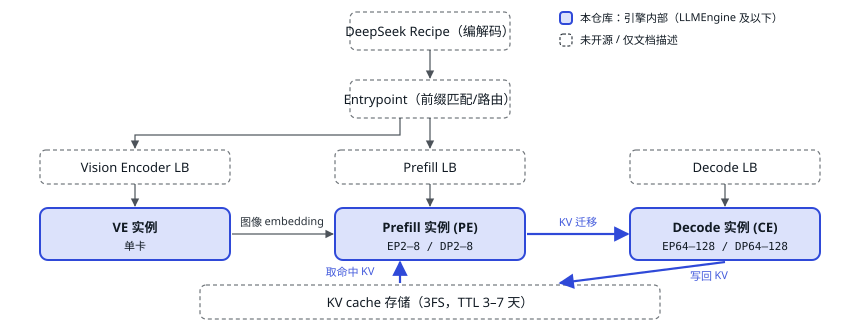

# 01 定位与开源边界

> 先弄清楚这个仓库是完整服务里的哪一块，读代码时才知道哪些「空函数」是故意留空的。

DeepSeek 的线上推理是 **E/P/D 分离**（Vision Encoder / Prefill / Decode 三类实例分开部署）的集群系统。DeepInfer 开源的是其中**单个推理引擎内部**的全部逻辑：调度、模型执行、采样、并行通信和 kernel。负载均衡器、KV cache 存储（3FS）和 P→D 迁移与内部基础设施耦合，没有开源。

<small>实线蓝框是 DeepInfer 代码真正覆盖的范围。三类引擎在仓库里是同一个 `LLMEngine`，靠 `EngineType`（NORMAL / PROMPT / COMPLETION）区分；离线示例全部跑 NORMAL，即同一个引擎里既做 prefill 也做 decode。依据 `doc/inference_deployment_qa.md`。</small>

#### `开源` 引擎内能读到的

- C++ 调度器、块管理器、MTP 变长验证调度
- V4.1 模型（mHC、稀疏注意力、Engram、YoCo、MoE、ViT）
- 采样器、DSpark 草稿模型、结构化输出
- DP/EP/CP 通信、EPLB、CUDA Graph
- ~30 个 TileLang 自定义 kernel（CUDA + 昇腾两套）

#### `留空` 读到会是「虚函数」的

- PD 分离：`init_pd_split`、`send_processed_prompts`
- KV 落盘：`do_save_kvcache`、`pe_do_save_kvcache`
- 跨请求前缀命中：`hit_tokens` 由外部注入
- 在线服务封装（只有离线 `LLM` 类）

源码：[`llm_engine.py:800–858`](https://github.com/deepseek-ai/DeepInfer/blob/9bd9cf243fc53ef9afbf8f04d391d989117d6ab9/deepinfer/engine/llm_engine.py#L800)

> [!NOTE]
> <strong>和 vLLM 的关系：</strong>DeepInfer 最初主要基于 vLLM 构建（文件头仍写着 `Derived from vLLM`），对外 API（`LLM`、`SamplingParams`、`LLMEngine.step`）和 vLLM 很像；但热路径几乎都换成了 C++（调度、输入元数据准备）和 TileLang/DeepGEMM/FlashMLA kernel，并且只服务一个模型家族。第二部分会先把 vLLM 讲清楚，第三部分再逐项对比。

---

[← 目录](../index.md) · [交互版本节](https://middle-chunjie.github.io/deepinfer-visual-guide/interactive/#pos) · [下一篇 →](./02-repo-map.md)
