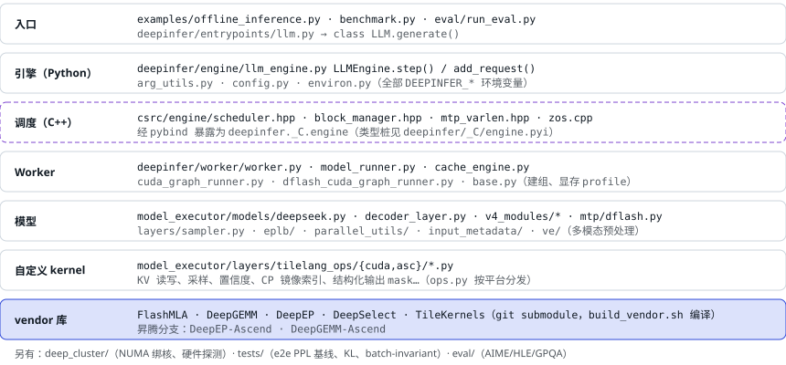

# 02 仓库地图

> 按调用深度从上往下排。越往下越接近 GPU，也越接近性能。

<small>虚线框是 C++：调度和输入元数据准备都在这里，Python 里以 `Scheduler`、`BlockManager` 等对象出现，读到它们就跳到 `csrc/engine/`。对照 vLLM：vLLM 的调度器、KV 管理器、输入准备都是 Python（`vllm/v1/core/`、`vllm/v1/worker/`），kernel 层则大量复用 FlashAttention / FlashInfer / FlashMLA / DeepGEMM 等同类库。</small>

---

[← 上一篇](./01-positioning.md) · [交互版本节](https://middle-chunjie.github.io/deepinfer-visual-guide/interactive/#map) · [下一篇 →](./03-processes.md)
