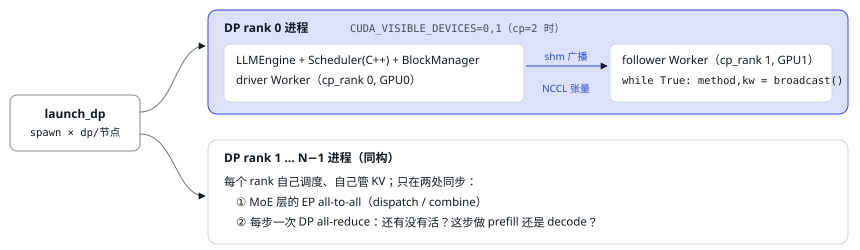

# 03 进程模型与启动

> 搞清楚「几个进程、谁和谁通信」，后面的并行代码才看得懂。

GPU 被切成若干个 **DP rank**（data parallel，数据并行副本），每个 DP rank 是一个独立进程，里面有一个完整的 `LLMEngine`：自己的调度器、自己的 KV cache、自己的一批请求。如果开了 CP（context parallel），一个 DP rank 再占 `cp` 张卡：0 号卡是 driver worker，跑在引擎进程里；其余卡各起一个 follower 进程，死循环等 driver 广播要执行的方法名。

<small>没请求的 DP rank 也得陪跑一个 placeholder forward，否则别的 rank 会卡在 MoE 的 all-to-all 上（`worker.py:126`）。vLLM 的 DP+EP 部署有同样的约束：空闲 rank 跑 dummy batch，并有一个 DP coordinator 进程同步 MoE 模型的 forward。示例脚本里的 `WORLD_SIZE` 指**节点数**，不是 torch 的 world size。</small>

## 引擎初始化顺序

1. `_init_workers`：起 CP follower 进程，构造 driver `Worker`；Worker 里绑 NUMA/CPU、建进程组。[`llm_engine.py:368`](https://github.com/deepseek-ai/DeepInfer/blob/9bd9cf243fc53ef9afbf8f04d391d989117d6ab9/deepinfer/engine/llm_engine.py#L368)
2. `load_model`：先初始化 Engram 的压缩词表，再加载权重。[`base.py:203`](https://github.com/deepseek-ai/DeepInfer/blob/9bd9cf243fc53ef9afbf8f04d391d989117d6ab9/deepinfer/worker/base.py#L203)
3. `profile_num_available_blocks`：跑一次最大 batch 的 dummy forward 测峰值显存，剩余显存 × `gpu_memory_utilization` 减去 state cache 后除以每块字节数，所有 rank 取平均。vLLM 的 `determine_available_memory` 也是同一套「先 profile 再把剩下的都给 KV」的思路。[`base.py:212`](https://github.com/deepseek-ai/DeepInfer/blob/9bd9cf243fc53ef9afbf8f04d391d989117d6ab9/deepinfer/worker/base.py#L212)
4. `init_cache_engine` 分配 KV；`warm_up_model` 捕获 decode CUDA Graph，并在开启变长验证时实测每个 graph 尺寸的耗时，得到 `decode_perf_curve`。[`base.py:274`](https://github.com/deepseek-ai/DeepInfer/blob/9bd9cf243fc53ef9afbf8f04d391d989117d6ab9/deepinfer/worker/base.py#L274)
5. 最后才构造 C++ `BlockManager` 和 `Scheduler`，因为它们需要上一步算出的块数。[`llm_engine.py:265`](https://github.com/deepseek-ai/DeepInfer/blob/9bd9cf243fc53ef9afbf8f04d391d989117d6ab9/deepinfer/engine/llm_engine.py#L265)

---

[← 上一篇](./02-repo-map.md) · [交互版本节](https://middle-chunjie.github.io/deepinfer-visual-guide/interactive/#boot) · [下一篇 →](./04-inference-basics.md)
