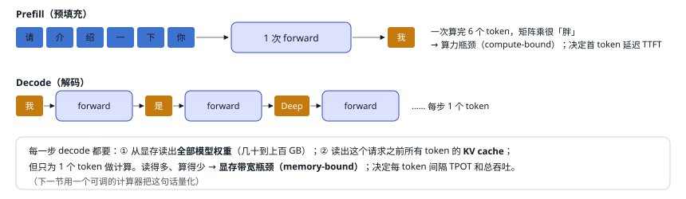

# 04 推理到底在算什么

> 所有推理框架都在优化同一个循环。先把这个循环画出来。

大模型是**自回归**生成的：每次 forward 只产出下一个 token，把它接到输入末尾，再 forward 一次。一个请求的生命周期分成两个阶段，它们的计算特性完全不同：

<small>线上服务里，同一时刻有成百上千个请求，各自处在 prefill 或 decode 的不同位置。推理框架的核心工作就是：每一步挑哪些请求、各算几个 token、怎么把它们拼成一次高效的 GPU 计算。</small>

## 术语表（后文会反复出现）

| 术语 | 含义 |
| --- | --- |
| `token` | 模型处理的最小单位，中文大约 1–2 个字一个 token。 |
| `forward / step` | 模型跑一次前向计算。框架里「一步」= 调度 + 一次 forward + 采样 + 后处理。 |
| `prefill / decode` | 处理输入 prompt / 逐个生成输出 token 的两个阶段。 |
| `TTFT / TPOT` | 首 token 延迟 / 每个输出 token 的间隔。前者看 prefill，后者看 decode。 |
| `吞吐 throughput` | 每秒每卡产出多少 token，决定成本。和延迟互相拉扯：batch 越大吞吐越高，但每个请求变慢。 |
| `batch` | 一次 forward 里同时处理的请求（或 token）集合。 |
| `KV cache` | 注意力层为已处理 token 缓存的 Key/Value 向量，避免每步重算历史，见第 06 节。 |
| `kernel` | 在 GPU 上执行的一个函数（一次矩阵乘、一次注意力…）。CPU 每发射一个 kernel 有几微秒开销。 |
| `CUDA Graph` | 把一串 kernel 录下来、之后一次性重放，省掉逐个发射的 CPU 开销。 |
| `MoE` | Mixture of Experts：FFN 换成很多个「专家」，每个 token 只激活其中几个。参数多、单 token 计算少。 |
| `TP / DP / EP / CP` | 张量并行（切矩阵）/ 数据并行（复制整份，各跑各的请求）/ 专家并行（把专家分到不同卡）/ 上下文并行（把一条长序列切到多卡）。见第 16 节。 |
| 集合通信 | 多张卡一起参与的数据交换：**all-reduce**（加总，人人拿到总和）、**all-gather**（拼接，人人拿到全部）、**all-to-all**（每卡给每卡发不同内容）、**broadcast**（一份发给所有卡）。详见第 16 节「先看懂：并行方式和通信方式」。 |
| `NCCL` / `NVLink` | NCCL 是 NVIDIA 的多卡通信库；NVLink 是 GPU 之间的高速互联。 |
| `FP8 / FP4` | 8 位、4 位浮点格式。比 BF16 少读一半或四分之三的字节，配合 scale（缩放因子）保持精度。 |

---

[← 上一篇](./03-processes.md) · [交互版本节](https://middle-chunjie.github.io/deepinfer-visual-guide/interactive/#basics) · [下一篇 →](./05-memory-bound.md)
