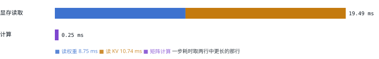
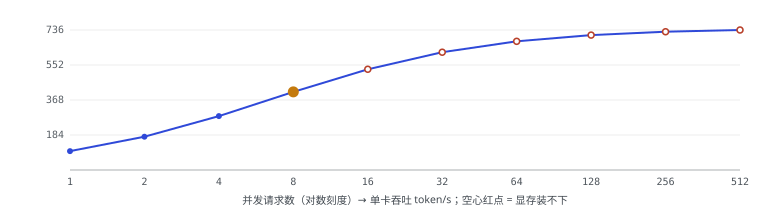

# 05 瓶颈：显存带宽

> 这是全篇最重要的一节。DeepInfer 的几乎每一项优化，都能用这里的一个公式解释。

GPU 一步 decode 的耗时，大致取决于两件事里更慢的那个：**把数据从显存搬到计算单元**的时间，和**真正做乘加**的时间。

```text
一步耗时 ≈ max( 读权重 + 读 KV  ÷ 显存带宽 ,  2 × 参数量 × 本步 token 数 ÷ 峰值算力 )
```

以 SM100（B200 级）为例：显存带宽约 8 TB/s，FP8 稠密算力约 4.5 PFLOPS（DeepInfer 自己记的 BF16 峰值是 2250 TFLOPS，FP8 取 2 倍，见 [`device.py:151`](https://github.com/deepseek-ai/DeepInfer/blob/9bd9cf243fc53ef9afbf8f04d391d989117d6ab9/deep_cluster/hardware/device.py#L151)）。下面用一个 70B 稠密、FP8 权重的**玩具模型**感受量级：

[▶ 在交互版中拖动参数](https://middle-chunjie.github.io/deepinfer-visual-guide/interactive/#roof)

下图是交互版默认参数（8 个并发、32K 上下文、GQA、不开投机）时的耗时分解和吞吐曲线：





同一个玩具模型在 32K 上下文下的几组对照（单卡吞吐 token/s；✗ 表示 KV 装不下）：

| 并发请求数 | GQA（Llama-3-70B 式） | MLA（DeepSeek-V3 式） | V4.1-Flash 式 | V4.1 式 + 投机解码 |
| --- | --- | --- | --- | --- |
| 1 | 99（10.1 ms） | 111（9.0 ms） | 114（8.8 ms） | 366（8.8 ms） |
| 8 | 411（19.5 ms） | 724（11.1 ms） | 911（8.8 ms） | 2,915（8.8 ms） |
| 16 | ✗ | 1,198（13.4 ms） | 1,815（8.8 ms） | 5,809（8.8 ms） |
| 64 | ✗ | ✗ | 7,105（9.0 ms） | 17,143（11.9 ms） |
| 256 | ✗ | ✗ | 26,178（9.8 ms） | 17,143（47.8 ms） |

<small>模型：读权重 70 GB/步；计算 2×70G FLOP/token；KV 每 token 字节数 GQA 320 KB、MLA 68.6 KB（BF16）、V4.1 ≈0.9 KB + 每请求约 3 MB 滑窗状态（按 config 与 KV 共享规则估算，见第 12 节）；显存 180 GB，权重之外的都给 KV。开投机解码时本步计算量 ×6，按文档的平均接受长度每步产出 ≈3.2 token。忽略注意力本身的计算、通信和 kernel 效率，只用来理解量级。</small>

## 从这个公式能读出的五条「加速杠杆」

| 杠杆 | 为什么有用 | 常见做法 | DeepInfer 里的对应 |
| --- | --- | --- | --- |
| ① 加大 batch | 权重读一次，摊给更多 token；decode 在 batch 很大之前都是「免费」变多 | 连续批处理（第 07 节） | Wide-EP 让每卡并发更多（第 16 节） |
| ② 少读 KV | 长上下文、大 batch 时 KV 读取会超过权重；还决定显存能装下多少请求 | GQA、MLA、KV 量化 | 压缩 KV + 跨层共享 + 稀疏检索 + FP4（第 12 节） |
| ③ 每步多产 token | memory-bound 时多算几个 token 几乎不加时间 | 投机解码 | DSpark 并行草稿 + 置信度变长验证（第 14 节） |
| ④ 少读权重 | 每卡要读的权重越少，每步越快 | 量化；张量并行把权重切开 | FP4 专家 + 64–128 卡专家并行，每卡只读 7 个专家（第 16 节） |
| ⑤ 去掉 GPU 等 CPU 的时间 | 一步只有几毫秒，CPU 调度、发 kernel 的开销占比很高 | CUDA Graph、异步调度 | C++ 调度 + ZOS + 全图 decode CUDA Graph（第 09–10 节） |

> [!TIP]
> <strong>记住这一节的结论：</strong>decode 慢不是因为「算不过来」，而是因为「搬不过来」。所以优化的方向是：让每次搬运服务更多 token（①③），或者让要搬的东西变少（②④），再把 GPU 空等的时间去掉（⑤）。

---

[← 上一篇](./04-inference-basics.md) · [交互版本节](https://middle-chunjie.github.io/deepinfer-visual-guide/interactive/#roof) · [下一篇 →](./06-kv-cache.md)
