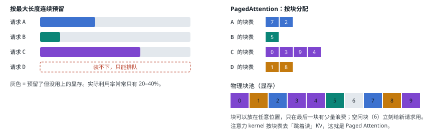

# 06 KV cache 与 PagedAttention

> KV cache 是推理框架管理的最重要的资源，也是 vLLM 成名的原因。

## KV cache 是什么

注意力层里，每个 token 会算出一个 Query、一个 Key、一个 Value。生成第 t 个 token 时，它的 Query 要和前面**所有** token 的 Key 做点积、再对 Value 加权求和。前面 token 的 K、V 不会变，所以第一次算完就存起来，后面每步直接读：这就是 KV cache。代价是它占显存，并且随上下文线性增长：

```text
每 token KV 字节 = 层数 × KV 头数 × 每头维度 × 2（K 和 V）× 每元素字节
Llama-3.1-70B（GQA，BF16）= 80 × 8 × 128 × 2 × 2 B = 320 KB / token  →  32K 上下文 ≈ 10 GB / 请求
```

显存能装下多少请求的 KV，直接决定了 batch 能开多大，也就决定了上一节的吞吐上限。

## vLLM 的解法：PagedAttention

早期框架给每个请求按「最大可能长度」预留一整段连续显存，但大多数请求根本用不满，浪费严重，还有碎片。vLLM（2023，SOSP 论文）借鉴操作系统的虚拟内存分页：把 KV 切成固定大小的**块**（vLLM 默认 16 token 一块），每个请求用一张**块表**把逻辑块映射到任意位置的物理块，按需分配。



<small>块化之后还顺带得到了两个能力：① **前缀共享**：两个请求的开头一样（同一个系统提示词），可以让块表指向同一批物理块，引用计数管理；② **抢占**：显存不够时把某个请求的块释放掉，之后重算。DeepInfer 的 C++ `BlockManager` 也是这套「空闲链表 + 引用计数」，只是块大小为 128 token。[`block_manager.hpp:27`](https://github.com/deepseek-ai/DeepInfer/blob/9bd9cf243fc53ef9afbf8f04d391d989117d6ab9/csrc/engine/block_manager.hpp#L27)</small>

---

[← 上一篇](./05-memory-bound.md) · [交互版本节](https://middle-chunjie.github.io/deepinfer-visual-guide/interactive/#kvbasic) · [下一篇 →](./07-vllm.md)
