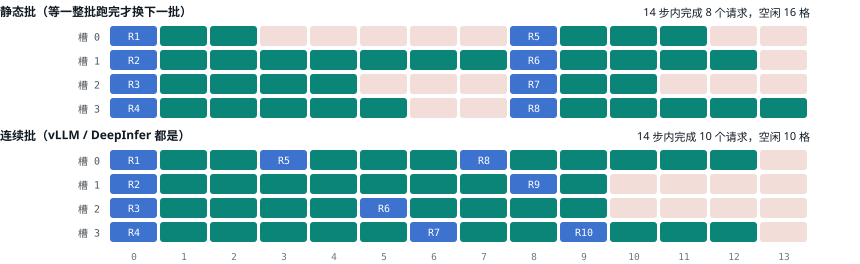
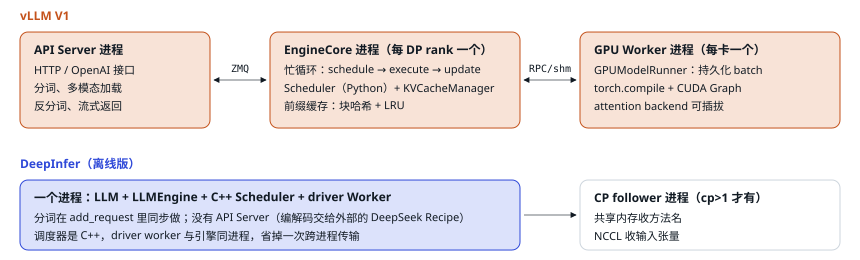

# 07 vLLM 是怎么设计的

> vLLM 是目前最常用的开源推理框架，也是 DeepInfer 的出发点。理解它的设计取舍，才能看懂 DeepInfer 为什么改。

## ① 连续批处理：每一步都可以换人

最朴素的做法是「静态批」：凑够一批请求一起跑，等最长的那个结束才放下一批进来。短请求早早结束后，它的位置一直空着。Orca（OSDI 2022）提出**迭代级调度**：每一步 forward 之后都重新调度，结束的请求立刻腾出位置，新请求下一步就能加入。vLLM 把它和 PagedAttention 结合起来，成为今天所有框架的标配。

图例：蓝＝prefill（请求的第一步）；青绿＝decode；浅红＝空闲槽位

<small>4 个槽位、10 个请求（输出长度 2–8 步），R 编号标在每个请求的第一步。纵向是槽位，横向是 step。静态批在第一批里最长的请求跑完前，其他槽位一直空着；连续批在请求结束的下一步就把新请求放进来。</small>

## ② vLLM V1 的进程结构

<small>vLLM V1 把调度循环单独放进 EngineCore 进程，是为了让分词、反分词、HTTP 这些 CPU 活不和调度抢 Python GIL。DeepInfer 开源版只有离线接口，而线上的协议转换和分词由单独的 Rust 组件 DeepSeek Recipe 完成，所以引擎进程里不需要这层隔离。</small>

## ③ vLLM 的几个关键设计和它们的理由

| 设计 | 做法 | 为什么这样设计 |
| --- | --- | --- |
| 统一调度器 | 不区分 prefill/decode，每步输出 `{请求: 本步 token 数}`。先把所有 decode 请求排进去，剩下的 token 预算（`max_num_batched_tokens`）给 prefill，长 prompt 自动切块（chunked prefill） | 一个抽象同时覆盖 chunked prefill、前缀缓存、投机解码；decode 请求永远不会被长 prefill 卡住；对任何模型都适用 |
| 前缀缓存 | 每个满块按「父块哈希 + 本块 token」算哈希，命中就直接复用；LRU 淘汰；V1 默认开启 | 多轮对话、相同系统提示极常见；哈希实现的开销低到 0 命中率时吞吐损失 &lt;1% |
| 持久化 batch | Worker 缓存输入张量，每步只应用增量；2026 年的 Model Runner V2 进一步把输入准备搬到 GPU 上用 Triton kernel 做 | 小模型一步 GPU 只要 ~5 ms，Python 准备输入的开销占比很大 |
| CUDA Graph | 默认 `FULL_AND_PIECEWISE`：纯 decode batch 用整图；混合 batch 用「分段图」，注意力留在 eager 模式 | 混合 batch 里 prefill 长度千变万化，很多注意力后端无法整图捕获；分段图保证兼容所有后端 |
| 异步调度 | `--async-scheduling`：GPU 跑第 N 步时 CPU 调度第 N+1 步；v0.19 起支持与投机解码同时开 | 同上，消除 GPU 空等；但和投机解码一起做很难，V1 里是后补的，MRV2 才作为核心约束重写 |
| 投机解码 | ngram、EAGLE/EAGLE3、MTP、小草稿模型；每步固定 `num_speculative_tokens` 个草稿，拒绝采样验证 | 通用：任意模型都能接一个草稿器 |
| MoE 部署 | `--data-parallel-size N --enable-expert-parallel`：注意力 DP、MoE EP；all-to-all 后端可选 DeepEP 等；EPLB 默认窗口 1000 步、每 3000 步重排、冗余专家默认 0 | 与 DeepSeek-V3 推理系统公开的做法一致；参数取保守默认值 |

## ④ 通用框架 vs 专用框架：一张总对比

vLLM 要支持几百种模型、几十种硬件和部署方式，所以它的每个设计都优先「通用、可插拔、默认安全」。DeepInfer 只服务 DeepSeek V4.1 一个模型、两种硬件、一种部署形态（大规模 E/P/D 分离），可以把通用性换成性能：

| 维度 | vLLM | DeepInfer | DeepInfer 这样做的理由 |
| --- | --- | --- | --- |
| 调度粒度 | 每步混合 prefill 块 + decode | 每步只做一种，DP 组投票决定 | 64 卡 DP+EP 要步调一致；decode 步可以整图捕获（第 09 节） |
| 调度器语言 | Python | C++（GIL 释放） | decode 一步只有几毫秒，调度必须远快于 GPU |
| CUDA Graph | 分段图 + 纯 decode 整图 | 只捕获 decode，整图含注意力，按 token 数分桶 | 没有混合 batch，整图总能捕获（第 10 节） |
| KV 管理 | 每层一份分页 KV；混合注意力有专门的管理器 | 两套分配器：128-token 块管压缩 KV，每序列槽位管滑窗状态 | V4.1 的 KV 分成可分页的和固定大小的两类（第 12 节） |
| 前缀缓存 | GPU 内存里，哈希块 + LRU | 外部 3FS 存 3–7 天，引擎只接收命中长度 | 跨机器命中、保留时间远长于显存能承受的（第 13 节） |
| 投机解码 | 固定草稿数，草稿多为逐个生成 | 草稿一次并行出 5 个，置信度决定每个请求验证几个 | 草稿成本更低，验证算力花在最可能被接受的位置（第 14 节） |
| 并行规模 | 常见 TP 单机，或 DP+EP | decode 用 EP64–128，不用 TP | MLA 只有 1 个 KV 头，TP 会复制 KV；宽 EP 让每卡读的专家权重最少（第 16 节） |
| 硬件抽象 | 插件式 platform，几十种后端 | 两套 kernel：CUDA 与昇腾，同名同语义 | 只追两种硬件的极致性能（第 17 节） |

> [!WARNING]
> <strong>关于 vLLM 资料的说明：</strong>vLLM 变化很快，本文参照的是 V1 架构文档、v0.1x 系列的部署指南和 2026 年 3 月的 Model Runner V2 博客。具体默认值请以你使用的版本为准。

---

[← 上一篇](./06-kv-cache.md) · [交互版本节](https://middle-chunjie.github.io/deepinfer-visual-guide/interactive/#vllm) · [下一篇 →](./08-request-journey.md)
