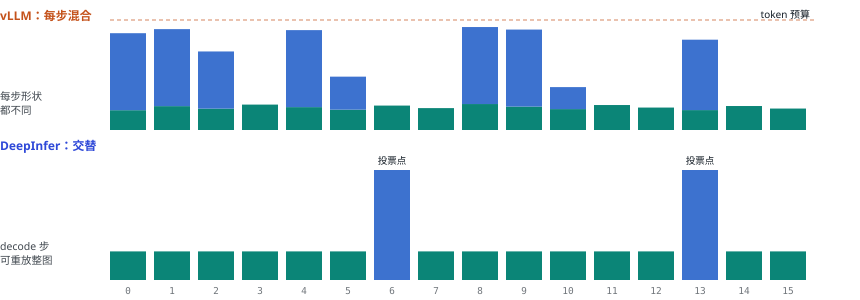
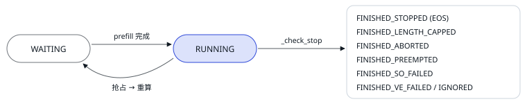

# 09 调度器

| 直觉 | vLLM 的做法 | DeepInfer 的做法 |
| --- | --- | --- |
| 调度器每步回答三个问题：跑哪些请求？每个请求算几个 token？显存不够时牺牲谁？答案决定了 batch 的形状，也就决定了第 05 节公式里的「本步 token 数」。 | Python 统一调度器：一个 token 预算，decode 先占，剩下的给 prefill 块。同一步里 prefill 和 decode 混在一起。 | C++ 调度器：一步要么全 prefill、要么全 decode，由整个 DP 组投票决定；decode 步的每请求 token 数由投机解码的置信度决定。 |

## 为什么不混批？

图例：青绿＝decode token；蓝＝prefill token

<small>柱高 = 本步处理的 token 数（示意）。vLLM：每步 decode + 一块 prefill，形状每步都不一样。DeepInfer：绝大多数步是形状稳定的纯 decode 步，可以直接重放 CUDA Graph；prefill 攒到投票点，全组 64 个 rank 同时做一个大 prefill 步。</small>

混批在单机、小模型上是最优解，但 DeepInfer 的场景有三个约束：

1. <strong>EP 要求全组步调一致。</strong>64 个 DP rank 在每个 MoE 层都要做 all-to-all。如果 rank 0 这步在做 30K token 的 prefill、rank 1 只做 64 个 token 的 decode，rank 1 每层都要等 rank 0，decode 延迟被 prefill 拖垮。
2. <strong>decode 步要能整图捕获。</strong>纯 decode 步的形状只由「总 token 数」决定，可以预先录好 CUDA Graph；混了 prefill 就只能 eager 或分段图。
3. <strong>线上本来就是 PD 分离。</strong>Prefill 和 decode 跑在不同实例上（第 01 节），NORMAL 引擎的「交替」只是离线/小规模部署时的折中。

## DP 组投票

| 投票点 | 间隔（decode 步） | 规则 | 目的 |
| --- | --- | --- | --- |
| ALL 点 | 70 | 所有 rank 都有待做 prefill 且 KV 占用 ≤ 90% 才做 | 避免一个 rank 干活、63 个 rank 陪跑空 prompt step |
| ANY 点 | 100 | 任一 rank 有活就全组做 | 兜底：孤立 rank 的请求最多等 100 个 decode 步 |
| 二次投票 | — | 确认组内确实有 rank 排出了 prefill，否则退回 decode | 防止「running 满 + waiting 非空」时空 prompt step 死循环 |

源码：[`scheduler.hpp:275 _schedule`](https://github.com/deepseek-ai/DeepInfer/blob/9bd9cf243fc53ef9afbf8f04d391d989117d6ab9/csrc/engine/scheduler.hpp#L275) · [`environ.py:174 间隔默认值`](https://github.com/deepseek-ai/DeepInfer/blob/9bd9cf243fc53ef9afbf8f04d391d989117d6ab9/deepinfer/environ.py#L174)

## prefill：分块、按 token 预算装箱

- 从 `waiting` 队头 FIFO 取请求，按 `max_num_batched_tokens` 截断成 chunk，CP 时 chunk 长度对齐到 `2·cp`。这部分和 vLLM 的 chunked prefill 一样。
- 多模态请求不允许把一张图切到两个 chunk 里：`_adjust_chunk_size` 会把切点挪到图片边界。[`scheduler.hpp:235`](https://github.com/deepseek-ai/DeepInfer/blob/9bd9cf243fc53ef9afbf8f04d391d989117d6ab9/csrc/engine/scheduler.hpp#L235)
- fork 出来的请求（`branch_id` 以 `_` 开头）pin 住父请求的 KV 块，只复制最后一个写了一半的块：这是仓库里唯一的「前缀共享」。跨请求的哈希前缀缓存在外部 KV 系统里，不像 vLLM 在调度器内部做。

## decode：块不够就抢占

decode 时先把 `running` 按输出长度降序排，从输出最短的一端开始分配新块，块不够时从另一端抢占（`_preempt`）。被抢占的请求要么回到 waiting 重算，要么在 `stop_preempted_request=True`（EngineArgs 默认）时直接结束；离线 `LLM` 把它改成了 False。vLLM V1 的抢占也是「释放块、之后重算」，不再像 V0 那样换出到 CPU。[`scheduler.hpp:622`](https://github.com/deepseek-ai/DeepInfer/blob/9bd9cf243fc53ef9afbf8f04d391d989117d6ab9/csrc/engine/scheduler.hpp#L622)

> [!WARNING]
> <strong>读代码时留意：</strong>`scheduler.hpp:557` 的注释写「抢占 output 最短的 seq」，但按 `:623` 的降序排序和 `:631` 从下标 `l=0` 开始取 victim，实际先被抢占的是输出最长的。以代码为准。

## 乐观推进 + 事后回填

开了投机解码后，decode 一步的 `seqlen_q = 1 + 参与验证的草稿数`，但事先不知道会接受几个。处理输出时先按 `seqlen_q` 把 `cache.num_tokens` 乐观推进，再按实际接受的 token 数 `commit_processed_tokens` 回填。被拒绝草稿写进去的 KV 不清零，下一步直接覆盖。[`scheduler.hpp:927`](https://github.com/deepseek-ai/DeepInfer/blob/9bd9cf243fc53ef9afbf8f04d391d989117d6ab9/csrc/engine/scheduler.hpp#L927) [`:997`](https://github.com/deepseek-ai/DeepInfer/blob/9bd9cf243fc53ef9afbf8f04d391d989117d6ab9/csrc/engine/scheduler.hpp#L997)

<small>`SequenceStatus` 枚举，`is_finished` 用 `status ≥ FINISHED_STOPPED` 判断。[`sequence.hpp:30`](https://github.com/deepseek-ai/DeepInfer/blob/9bd9cf243fc53ef9afbf8f04d391d989117d6ab9/csrc/engine/sequence.hpp#L30)</small>

---

[← 上一篇](./08-request-journey.md) · [交互版本节](https://middle-chunjie.github.io/deepinfer-visual-guide/interactive/#sched) · [下一篇 →](./10-cpu-overhead.md)
