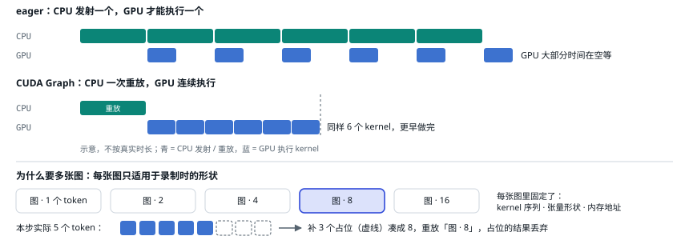
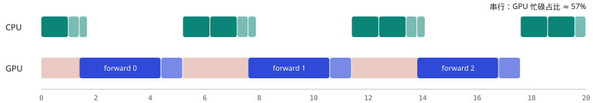
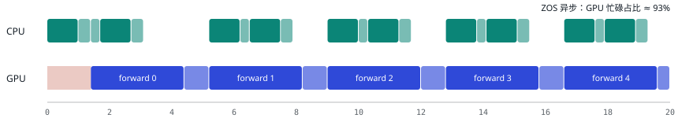
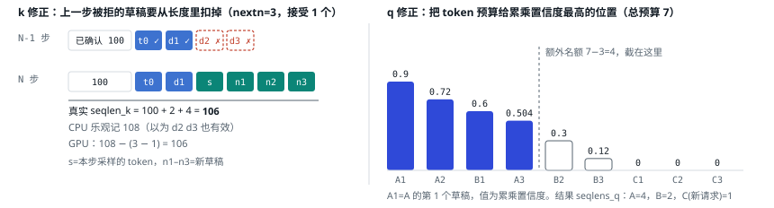

# 10 CPU 开销：异步调度与 CUDA Graph

| 直觉 | vLLM 的做法 | DeepInfer 的做法 |
| --- | --- | --- |
| GPU 一步 decode 只要几毫秒。如果 CPU 每步要花 1–2 ms 调度、准备输入、逐个发射几千个 kernel、再处理输出，GPU 有相当一部分时间在等 CPU。这是第 05 节的杠杆 ⑤。 | CUDA Graph（默认整图 + 分段图）消掉 kernel 发射开销；`--async-scheduling` 让 CPU 提前一步调度；Model Runner V2 把输入准备也搬到 GPU。 | 调度与输入准备用 C++；decode 整图捕获；ZOS（零开销调度）把第 N 步的后处理藏到第 N+1 步 forward 后面，长度修正在 GPU 上做，整条路径禁止 CPU-GPU 同步。 |

## 先看懂：eager 怎么跑，为什么要多张图

**eager（急切执行）是 PyTorch 的默认方式：代码执行到哪一行，就立刻让 GPU 做哪一步。**以一层里的几行为例：

```python
h = rmsnorm(x)          # 发射 kernel ①
q = h @ Wq              # 发射 kernel ②
k = h @ Wk              # 发射 kernel ③
a = attention(q, k, v)  # 发射 kernel ④
```

每一行背后，CPU 都要做一遍：Python 执行这一行，PyTorch 判断形状、选一个 kernel，再调用 CUDA 驱动，把「这个 kernel 加这些参数」放进 GPU 的任务队列。每次耗时在几微秒量级（凭经验的数量级，没有实测）。一步 decode 有 40 层、每层几十个 kernel，就是几千次发射。而 decode 时每个 kernel 本身只算几微秒到几十微秒，于是 CPU 发射得比 GPU 执行还慢，GPU 做完一个就得空等下一个。



<small>上半：eager 时 CPU 每发射一个 kernel，GPU 才能执行一个，中间有空隙；CUDA Graph 只需 CPU 一次重放，GPU 连续执行。下半：每张图只适用于录制时的形状，实际 token 数不够时补到最近的桶。</small>

**CUDA Graph 分两步：**① **录制（capture）**：先正常跑一遍这一步，但 CUDA 不执行，只记录「依次发射了哪些 kernel、各自的参数」，存成一个图。② **重放（replay）**：以后每步只调用一次「重放」，驱动一次性把整串 kernel 交给 GPU，CPU 只花一次发射的成本。

**为什么需要多张图：录下来的是死的**，重放时不会重新执行 Python 代码，而是原样照放：

- **形状写死**：矩阵乘用多少行、kernel 开多少个线程块，录制时就由形状决定了。batch 从 8 变成 5，同一份记录就不适用了。
- **地址写死**：kernel 参数里记的是输入输出张量的地址，所以重放前要把新数据拷进录制时用的那块固定缓冲区，不能换一块新的。
- **逻辑写死**：录制时走了哪个 `if` 分支，重放时就永远是那个分支。

所以每种形状要单独录一张图。decode 的形状主要由本步总 token 数决定，启动时按一组大小各录一张（第 03 节的 `warm_up_model`）。运行时实际是 5 个 token，就补到最近的更大桶：补 3 个占位 token 凑成 8，重放「图 · 8」，多算的结果丢掉。

多张图的代价：

| 代价 | 说明 |
| --- | --- |
| 启动时间 | 每张图都要录一次，图越多越久 |
| 显存 | 每张图自己记录 kernel 和参数；中间激活的显存通常可以共享（具体实现没有核对） |
| padding 浪费 | 桶分得粗，补的无用计算就多 |
| 灵活性 | 图里不能有依赖具体数值的 Python 逻辑 |

这也是 prefill 为什么直接 eager：一步算几千到几万个 token，每个 kernel 跑得久，几微秒的发射开销占比可以忽略，而且长度跨度太大，录不出足够的图。

## CUDA Graph：把几千次发射变成一次

一个 40 层 MoE 模型的一步 decode 由几千个 kernel 组成，每个 kernel 从 CPU 发射要几微秒，加起来可能和 GPU 计算时间相当。CUDA Graph 先把整串 kernel「录」下来，之后每步只需一次重放。限制是录下来的形状固定，所以要按 batch 大小分桶，各录一张图。

#### `vLLM` 为什么要分段图

混合 batch 里有长短不一的 prefill，注意力的形状每步都在变，很多注意力后端不能整图捕获。于是 vLLM 用 torch.compile 在注意力处把模型「切开」，注意力以外的部分录成图，注意力 eager 执行。纯 decode batch 再额外用整图（`FULL_AND_PIECEWISE`）。

#### `DeepInfer` 只录 decode，整图

因为一步只做一种（第 09 节），decode 步的形状只取决于总 token 数，注意力也能一起录。按 `build_graph_batch_sizes` 分桶：1、2、4，然后每 8 一档；实际 token 数向上取到最近的桶，用 padding 序列补齐。prefill 计算量大、发射开销占比小，直接 eager。[`cuda_graph_runner.py:41`](https://github.com/deepseek-ai/DeepInfer/blob/9bd9cf243fc53ef9afbf8f04d391d989117d6ab9/deepinfer/worker/cuda_graph_runner.py#L41)

## 异步调度：让 CPU 和 GPU 同时干活

串行流程是 `schedule(N) → forward(N) → sample(N) → 同步 → post_process(N)`，GPU 在后处理和下一步调度期间空闲。ZOS 把第 N 步的后处理推迟到第 N+1 步 forward 发射之后做，CPU 工作被藏进 GPU 计算里。NORMAL/COMPLETION 引擎默认开启。[`arg_utils.py:48`](https://github.com/deepseek-ai/DeepInfer/blob/9bd9cf243fc53ef9afbf8f04d391d989117d6ab9/deepinfer/engine/arg_utils.py#L48)





图例：青绿＝CPU：调度 / 发射 / 后处理；深蓝＝GPU：forward / sample；浅红＝GPU 空闲

<small>示意时长（非实测）：调度 1.0、发射 forward 0.4、发射 sample 0.3、后处理 1.0、GPU forward 3.0、sample 0.8，单位任意。代码结构见 `Worker.execute_model_step` 的四段：forward 当前步 → 后处理上一步 → sample 当前步 → 视情况后处理当前步。[`worker.py:89`](https://github.com/deepseek-ai/DeepInfer/blob/9bd9cf243fc53ef9afbf8f04d391d989117d6ab9/deepinfer/worker/worker.py#L89)</small>

## 难点：CPU 看到的状态晚一步

没有投机解码时，异步调度相对简单：每个请求每步固定多 1 个 token，下一步的长度可以提前算好。开了投机解码就麻烦了：调度第 N+1 步时，第 N 步还没验证完，CPU 不知道每个请求接受了几个草稿，也就不知道 KV 长度、下一步从哪个位置开始。vLLM 社区也提到这个组合在 V1 里很难做干净。DeepInfer 的做法：

- CPU 按「乐观假设」准备好 `seqlen_q/seqlen_k`，再由 C++ 的 `prepare_zos_inputs` 算出本步和上一步 batch 的对应关系 `remap`。[`zos.cpp`](https://github.com/deepseek-ai/DeepInfer/blob/9bd9cf243fc53ef9afbf8f04d391d989117d6ab9/csrc/engine/zos.cpp#L1)
- 在 GPU 上用上一步真实的接受数和置信度修正长度：`compute_seqlens_k_zos`、`compute_seqlens_q_by_confidence_rates`（两个 TileLang kernel）。[`worker.py:191`](https://github.com/deepseek-ai/DeepInfer/blob/9bd9cf243fc53ef9afbf8f04d391d989117d6ab9/deepinfer/worker/worker.py#L191)
- 上一步刚采出来的 token 直接在 GPU 上从 `prev_sampled_token_ids` 取，不回 CPU。[`zos_status.py:24`](https://github.com/deepseek-ai/DeepInfer/blob/9bd9cf243fc53ef9afbf8f04d391d989117d6ab9/deepinfer/worker/zos_status.py#L24)

### 乐观假设：CPU 先假设草稿全被接受

CPU 调度每个请求时，都把这一步按「吐出 nextn+1 个 token」记账：`max_seqlen_q = nextn + 1`，并执行 `start_inflight_step(max_seqlen_q)`，`seqlen_k = num_tokens + total_inflight_tokens + seqlen_q`。[`scheduler.hpp:689`](https://github.com/deepseek-ai/DeepInfer/blob/9bd9cf243fc53ef9afbf8f04d391d989117d6ab9/csrc/engine/scheduler.hpp#L689) 块表也按这个上限预留。这就是「乐观」：假设上一步的 nextn 个草稿全被接受。全接受时记账刚好对；只要有草稿被拒，CPU 的 `seqlen_k` 就偏大 `nextn − accepted`。（「乐观 = 全接受」是我从 `max_seqlen_q` 和下面的 kernel 公式反推的，源码里没有哪行直接这样写。）

GPU 上的 `compute_seqlens_k_zos` 用上一步真实的接受数把它改正（`num_accepted_tokens` 是被接受的草稿数，范围 0 到 nextn）：[`compute_seqlens_k_zos.py:10`](https://github.com/deepseek-ai/DeepInfer/blob/9bd9cf243fc53ef9afbf8f04d391d989117d6ab9/deepinfer/model_executor/layers/tilelang_ops/compute_seqlens_k_zos.py#L10)

```text
seqlens_k[i] += seqlens_q[i]
seqlens_k[i] -= nextn - prev_num_accepted_tokens[j]   # j = remap[i]，新请求（-1）不修正
```

`remap` 的作用：第 N 步的 batch 和第 N−1 步不一定同序（有请求结束、有新请求加入），要靠 `remap[i]=j` 找到「我在上一步是第几个」。[`zos.cpp:142`](https://github.com/deepseek-ai/DeepInfer/blob/9bd9cf243fc53ef9afbf8f04d391d989117d6ab9/csrc/engine/zos.cpp#L142) 这个修正是 GPU 上一个很小的原地 kernel，排在 H2D 拷贝之后、注意力之前，CPU 不用等，也没有同步。[`worker.py:191`](https://github.com/deepseek-ai/DeepInfer/blob/9bd9cf243fc53ef9afbf8f04d391d989117d6ab9/deepinfer/worker/worker.py#L191)

### 置信度修正 q 长度：把 token 预算花在更可能被接受的位置

开启 `DEEPINFER_ENABLE_MTP_VARLEN` 后，每个请求这步该验证几个草稿不再固定为 nextn。思路：各请求的草稿被接受的概率不同，总 token 预算应该给概率高的。输入是 CPU 定下的总预算 `total_q`，以及上一步 MTP 头给每个草稿打的置信度（上一步预测出的草稿，正好是这一步要验证的草稿，所以 GPU 上现成就有，不用回 CPU）。算法：

1. 对每个请求沿草稿位置做累乘：`cum[j] = r1×r2×…×rj`。第 j 个草稿要被接受，前 j−1 个必须先被接受。新请求（`remap=-1`）全记 0。
2. 把所有请求的所有位置放在一起，按累乘值从大到小排名，平手取序号小的。
3. 额外名额是 `total_q − num_seqs`（每个请求至少保 1 个 token）。排名靠前的位置拿到名额。
4. `seqlens_q[i] = 1 + 该请求拿到的位置数`。累乘不增，所以每个请求拿到的一定是一段前缀。

[`schedule_mtp_varlen.py:11`](https://github.com/deepseek-ai/DeepInfer/blob/9bd9cf243fc53ef9afbf8f04d391d989117d6ab9/deepinfer/model_executor/layers/tilelang_ops/schedule_mtp_varlen.py#L11) 修正后的 `seqlens_q` 会异步拷回 CPU，采样要用。[`worker.py:191`](https://github.com/deepseek-ai/DeepInfer/blob/9bd9cf243fc53ef9afbf8f04d391d989117d6ab9/deepinfer/worker/worker.py#L191)



<small>示意：左图是 seqlen_k 修正，右图是按累乘置信度分配 q 的 token 名额。数值是为说明算法编的例子，不是实测。</small>

这个例子里 nextn=3、三个请求，总预算 7，额外名额 7−3=4：A 的累乘是 0.9、0.72、0.504，B 是 0.6、0.3、0.12，C 是新请求全 0。九个位置里前四名是 A1、A2、B1、A3，所以 A 的 q=4、B 的 q=2、C 的 q=1，合计 7。

预算从哪来：CPU 的 `MTPVarlen::schedule` 根据 decode 性能曲线选 `total_q`，注释说它用 N−2 轮的接受率，而 GPU 上分配 q 用的是 N−1 轮的，更新一轮。[`mtp_varlen.hpp:160`](https://github.com/deepseek-ai/DeepInfer/blob/9bd9cf243fc53ef9afbf8f04d391d989117d6ab9/csrc/engine/mtp_varlen.hpp#L160) 性能曲线按 `graph_size` 索引，所以我推断总预算是对着 CUDA Graph 的桶选的，这样既没有 padding 浪费，也不用为变长另录图。这是推断，没有逐行验证。收益来自低置信度的草稿大概率被拒、白占算力；源码里没有给出具体的吞吐提升数字，这里也不估计。

整条路径上的 `execute_main_model`/`execute_sample` 都包在 `forbid_cuda_sync()` 里：一旦有人写了隐式同步（比如 `.item()`），直接报错。`tests/test_cuda_sync_guards.py` 专门测这个。

---

[← 上一篇](./09-scheduler.md) · [交互版本节](https://middle-chunjie.github.io/deepinfer-visual-guide/interactive/#zos) · [下一篇 →](./11-model.md)
