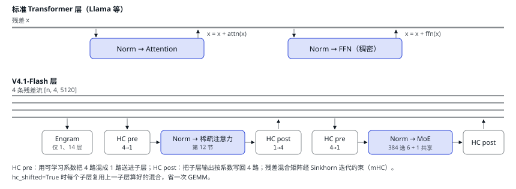

# 11 V4.1-Flash 模型结构

| 直觉 | vLLM 的做法 | DeepInfer 的做法 |
| --- | --- | --- |
| 推理框架是围着模型结构写的。V4.1 不是标准 Transformer：KV 有好几种、层与层之间共享 KV、残差流有 4 条、还有查表模块。这些结构决定了引擎里一半的特殊逻辑。 | 每个模型一个 Python 文件，复用通用的 Linear、Attention、FusedMoE 层；新结构往往要等通用层支持。 | 只有一个模型（`DeepseekVLForCausalLM`），每个模块都配了专用融合 kernel，比如 mHC 用 DeepGEMM 的 `mega_mhc`，MoE 用 Mega MoE。 |

## 先看标准 Transformer 层，再看 V4.1 改了什么

<small>mHC（manifold-constrained Hyper-Connections）把单条残差换成 4 条并行残差流。对推理框架的影响：激活宽了 4 倍，每个子层前后都多了一次小 GEMM 和 norm，所以 DeepInfer 用 DeepGEMM 的 `mega_mhc` 融合 kernel 一次做完（[`hc.py:270`](https://github.com/deepseek-ai/DeepInfer/blob/9bd9cf243fc53ef9afbf8f04d391d989117d6ab9/deepinfer/model_executor/models/v4_modules/hc.py#L270)）。前向循环见 [`deepseek.py:154`](https://github.com/deepseek-ai/DeepInfer/blob/9bd9cf243fc53ef9afbf8f04d391d989117d6ab9/deepinfer/model_executor/models/deepseek.py#L154)，单层见 [`decoder_layer.py:97`](https://github.com/deepseek-ai/DeepInfer/blob/9bd9cf243fc53ef9afbf8f04d391d989117d6ab9/deepinfer/model_executor/models/decoder_layer.py#L97)。</small>

## 43 个注意力模块逐层看

下面是每一层的配置（交互版里可以逐层点击查看）。数据来自 HF 上的 `config.json`（仓库本身不带 checkpoint），解析逻辑在 [`hugging_face/config.py`](https://github.com/deepseek-ai/DeepInfer/blob/9bd9cf243fc53ef9afbf8f04d391d989117d6ab9/deepinfer/hugging_face/config.py#L138)。

[▶ 在交互版中逐层点击查看](https://middle-chunjie.github.io/deepinfer-visual-guide/interactive/#model)

展开 43 个注意力模块的逐层配置表

| layer | 注意力 | 压缩 | YoCo 角色 | 压缩 KV 来自 | indexer 来自 | 其他 |
| --- | --- | --- | --- | --- | --- | --- |
| 0 | 纯 SWA | — | prefill 侧 | — | — |  |
| 1 | 纯 SWA | — | prefill 侧 | — | — | Engram |
| 2 | SWA + 稀疏 top-512 | C2（2→1） | prefill 侧 | **本层** | **本层** |  |
| 3 | SWA + 稀疏 top-512 | C2（2→1） | prefill 侧 | layer 2 | layer 2 |  |
| 4 | SWA + 稀疏 top-512 | C2（2→1） | prefill 侧 | layer 2 | layer 2 |  |
| 5 | SWA + 稀疏 top-512 | C2（2→1） | prefill 侧 | layer 2 | layer 2 |  |
| 6 | SWA + 稀疏 top-512 | C2（2→1） | prefill 侧 | layer 2 | layer 2 |  |
| 7 | SWA + 稀疏 top-512 | C2（2→1） | prefill 侧 | layer 2 | layer 2 |  |
| 8 | SWA + 稀疏 top-512 | C2（2→1） | prefill 侧 | **本层** | **本层** |  |
| 9 | SWA + 稀疏 top-512 | C2（2→1） | prefill 侧 | layer 8 | layer 8 |  |
| 10 | SWA + 稀疏 top-512 | C2（2→1） | prefill 侧 | layer 8 | layer 8 |  |
| 11 | SWA + 稀疏 top-512 | C2（2→1） | prefill 侧 | layer 8 | layer 8 |  |
| 12 | SWA + 稀疏 top-512 | C2（2→1） | prefill 侧 | layer 8 | layer 8 |  |
| 13 | SWA + 稀疏 top-512 | C2（2→1） | prefill 侧 | layer 8 | layer 8 |  |
| 14 | SWA + 稀疏 top-512 | C2（2→1） | prefill 侧 | **本层** | **本层** | Engram |
| 15 | SWA + 稀疏 top-512 | C2（2→1） | prefill 侧 | layer 14 | layer 14 |  |
| 16 | SWA + 稀疏 top-512 | C2（2→1） | prefill 侧 | layer 14 | layer 14 |  |
| 17 | SWA + 稀疏 top-512 | C2（2→1） | prefill 侧 | layer 14 | layer 14 |  |
| 18 | SWA + 稀疏 top-512 | C2（2→1） | prefill 侧 | layer 14 | layer 14 |  |
| 19 | SWA + 稀疏 top-512 | C2（2→1） | prefill 侧 | layer 14 | layer 14 |  |
| 20 | SWA + 稀疏 top-512 | C1 | 第一个 consumer | **本层** | **本层** | 候选块源 |
| 21 | SWA + 稀疏 top-512 | C1 | consumer | layer 20 | layer 20 |  |
| 22 | SWA + 稀疏 top-512 | C1 | consumer | layer 20 | layer 20 |  |
| 23 | SWA + 稀疏 top-512 | C1 | consumer | layer 20 | layer 20 |  |
| 24 | SWA + 稀疏 top-512 | C1 | consumer | layer 20 | **本层** |  |
| 25 | SWA + 稀疏 top-512 | C1 | consumer | layer 20 | layer 24 |  |
| 26 | SWA + 稀疏 top-512 | C1 | consumer | layer 20 | layer 24 |  |
| 27 | SWA + 稀疏 top-512 | C1 | consumer | layer 20 | layer 24 |  |
| 28 | SWA + 稀疏 top-512 | C1 | consumer | layer 20 | **本层** |  |
| 29 | SWA + 稀疏 top-512 | C1 | consumer | layer 20 | layer 28 |  |
| 30 | SWA + 稀疏 top-512 | C1 | consumer | layer 20 | layer 28 |  |
| 31 | SWA + 稀疏 top-512 | C1 | consumer | layer 20 | layer 28 |  |
| 32 | SWA + 稀疏 top-512 | C1 | consumer | layer 20 | **本层** |  |
| 33 | SWA + 稀疏 top-512 | C1 | consumer | layer 20 | layer 32 |  |
| 34 | SWA + 稀疏 top-512 | C1 | consumer | layer 20 | layer 32 |  |
| 35 | SWA + 稀疏 top-512 | C1 | consumer | layer 20 | layer 32 |  |
| 36 | SWA + 稀疏 top-512 | C1 | consumer | layer 20 | **本层** |  |
| 37 | SWA + 稀疏 top-512 | C1 | consumer | layer 20 | layer 36 | 特征送 DSpark |
| 38 | SWA + 稀疏 top-512 | C1 | consumer | layer 20 | layer 36 | 特征送 DSpark |
| 39 | SWA + 稀疏 top-512 | C1 | consumer | layer 20 | layer 36 | 特征送 DSpark |
| 40–42 | 纯 SWA（DSpark 草稿层） | — | — | — | — | 128 专家 top-3 小 MoE |

| 超参数 | 值 | 超参数 | 值 |
| --- | --- | --- | --- |
| 层数 / hidden | 40 / 5120 | 路由专家 / 共享 / top-k | 384 / 1 / 6 |
| 注意力头 / KV 头 / head_dim | 64 / 1 / 512 | 专家 FFN 宽度 | 2304 |
| q_lora / o_lora / o_groups | 1280 / 1024 / 8 | 门控 | sqrtsoftplus + noaux_tc |
| 滑窗 / indexer top-k | 128 / 512 | mHC 残差流数 / Sinkhorn 轮数 | 4 / 20 |
| 最大位置 / YaRN | 1M / ×16 | DSpark 层 / 草稿 MoE | 3 / 128 专家 top-3 |

#### MoE 为什么适合推理

384 个专家里每个 token 只用 6 个 + 1 个共享专家：总参数很大（知识多），单 token 计算量小。但第 05 节说过 decode 是 memory-bound：batch 一大，几乎所有专家都会被某个 token 选中，每步还是要把全部专家权重读一遍。所以 MoE 推理的关键是**把专家分散到很多卡上**（第 16 节）。

实现上：权重 FP4、激活 FP8；EP 组在一个 NVLink 域内时走 DeepGEMM 的融合 Mega MoE，否则走 DeepEP dispatch/combine。[`mlp.py:184`](https://github.com/deepseek-ai/DeepInfer/blob/9bd9cf243fc53ef9afbf8f04d391d989117d6ab9/deepinfer/model_executor/models/v4_modules/mlp.py#L184)

#### Engram：用查表换计算

挂在 layer 1 和 14：把 token 映射到压缩词表（99,092），取 2–4 阶 n-gram 的哈希，从约 3.8 亿行的表里查 embedding，门控加进残差。查表几乎不耗算力，但表很大，所以默认放在 CPU 内存，按 hash 跨 rank 分片取回。[`engram.py:127`](https://github.com/deepseek-ai/DeepInfer/blob/9bd9cf243fc53ef9afbf8f04d391d989117d6ab9/deepinfer/model_executor/models/v4_modules/engram.py#L127)

引擎侧的连锁影响：C++ 调度器也要维护一份「压缩词表下的 token 序列」，新生成的 token 要同时追加到两份序列里（`map_engram`）。

---

[← 上一篇](./10-cpu-overhead.md) · [交互版本节](https://middle-chunjie.github.io/deepinfer-visual-guide/interactive/#model) · [下一篇 →](./12-attention-kv.md)
