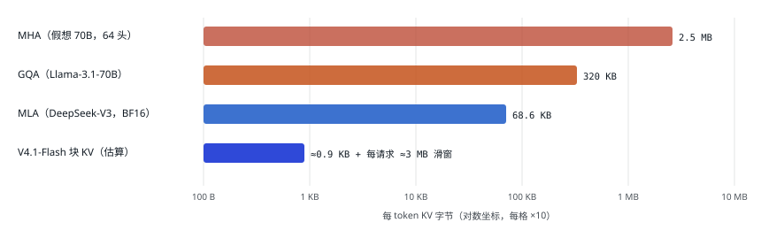
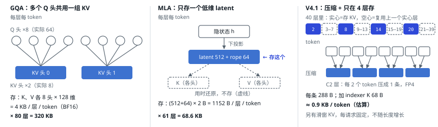
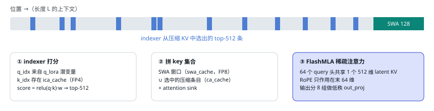
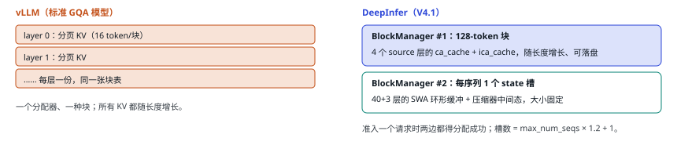

# 12 注意力与 KV 存储

| 直觉 | vLLM 的做法 | DeepInfer 的做法 |
| --- | --- | --- |
| KV cache 同时决定两件事：能装下多少并发请求（batch 上限），以及每步要读多少字节（第 05 节的 KV 项）。长上下文时它是头号瓶颈。 | 对标准模型：每层一份分页 KV，块大小 16 token，可选 FP8 KV；对 MLA、滑窗等结构由各自的 attention backend 和混合 KV 管理器适配。 | 模型本身就把 KV 压得极小：单头 latent + 2 倍压缩 + 40 层只有 4 层存块 KV + FP4。引擎相应地有两套分配器和 5 种 KV 张量。 |

## 每 token 要存多少 KV：一代比一代小

<small>计算：MHA = 80 层 × 64 头 × 128 × 2 × 2 B；GQA = 80 × 8 × 128 × 2 × 2 B；MLA = 61 层 × (512 + 64) × 2 B。V4.1 按 `kv_source_layer_ids` 只有 4 层存压缩 KV（3 个 C2 层每 2 token 一条、1 个 C1 层每 token 一条，每条 288 B），再加同样规律的 indexer K（每条 68 B），合计约 890 B/token；滑窗 KV 每层固定 ~134 条 × 528 B，与上下文长度无关。V4.1 的数字是我按 config 与 `cache_engine.py` 的共享规则推算的，没有在机器上实测。32K 上下文时 GQA 约 10 GB/请求，V4.1 约 32 MB/请求。</small>

三种做法具体存的是什么：

<small>示意图：为画得下，Q 头、KV 头、层数和 token 数都缩小了，真实数字写在文字里。数字来源：GQA 按 Llama-3.1-70B（80 层、64 个 Q 头、8 个 KV 头、head_dim 128），MLA 按 DeepSeek-V3（61 层、latent 512 + rope 64），V4.1 的第 20 层是 C1（每 token 一条，不压缩），图里只画了 C2 层，数字是我按 config 与 `cache_engine.py` 推算的，没有实测。MLA 的「用时还原」是概念画法，实际推理实现常把上投影合并进注意力计算，不显式还原。</small>

四代压缩分别靠什么：

1. **GQA**：多个 query 头共用一组 KV 头（64 → 8）。
2. **MLA**（DeepSeek-V2/V3）：所有头共用一个 512 维的潜变量（latent），计算时再「展开」。KV 只有 1 个头。
3. **V4.1 的压缩 KV**：C2 层把相邻 2 个 token 的 KV 压成 1 条；再加**跨层共享**：40 层里只有 layer 2、8、14、20 真正存 KV，其余层复用最近的 source 层。
4. **低精度**：主 KV 用 FP4（per-16 e4m3 scale），比 BF16 再小 4 倍。

## 只看一部分 KV：滑窗 + 稀疏检索

存得少还不够，每步读的也要少。标准注意力每个 query 要读完整的上下文；V4.1 每个 query 只看「最近 128 个 token」加「indexer 挑出来的 512 条压缩 KV」，读取量与上下文长度基本无关：

<small>indexer 本身也要扫一遍压缩后的 K，但它用的是 FP4、128 维的小向量，比主注意力便宜得多。纯 SWA 层（0、1）只有窗口；从 layer 20 起还多一级「候选块」：layer 20 的 indexer 先粗选 2048 个 8-token 块，后续层在候选里再选（依据 `candidate_source_layer_id` 配置与 [`index_attn.py:105`](https://github.com/deepseek-ai/DeepInfer/blob/9bd9cf243fc53ef9afbf8f04d391d989117d6ab9/deepinfer/model_executor/models/v4_modules/index_attn.py#L105)，粗精两级的语义是从代码推断的）。</small>

## KV 跨层共享的代码

`kv_source_layer_ids=[2,8,14,20]`：每一层复用「不晚于自己的最近一个 source 层」的 `ca_cache`，所以 layer 2–7 共用 layer 2 的，layer 20–39 全部共用 layer 20 的。indexer 模块同理，source 是 `[2,8,14,20,24,28,32,36]`。映射函数只有三行：[`config.py:62 _source_map`](https://github.com/deepseek-ai/DeepInfer/blob/9bd9cf243fc53ef9afbf8f04d391d989117d6ab9/deepinfer/hugging_face/config.py#L62)；复用别层 KV 的层不占新显存：[`cache_engine.py:165`](https://github.com/deepseek-ai/DeepInfer/blob/9bd9cf243fc53ef9afbf8f04d391d989117d6ab9/deepinfer/worker/cache_engine.py#L165)。每层自己的 SWA KV 则逐层独立。

| 张量 | 形状（每层） | 每条字节 | 按什么分配 | 落盘 |
| --- | --- | --- | --- | --- |
| `ca_cache` 压缩主 KV | [blocks, 128/ratio, 1, B] | 288（FP4 per-16）/ 528（MXFP8） | 块（128 token） | 是（3FS） |
| `ica_cache` indexer K | [blocks, 128/ratio, 1, 68] | 68（MXFP4） | 块 | 是 |
| `swa_cache` 滑窗 KV | [state_slots, 窗口+余量, 1, 528] | 528（FP8 + ue8m0） | 每序列一个 state 槽（环形） | 前 20 层落本机内存 |
| `ca_state / ica_state` | [state_slots, ring, 2, dim] fp32 | — | state 槽 | 否 |

源码：[`cache_engine.py:206 KVCache`](https://github.com/deepseek-ai/DeepInfer/blob/9bd9cf243fc53ef9afbf8f04d391d989117d6ab9/deepinfer/worker/cache_engine.py#L206) · [`cache_common.py:109 字节布局`](https://github.com/deepseek-ai/DeepInfer/blob/9bd9cf243fc53ef9afbf8f04d391d989117d6ab9/deepinfer/model_executor/layers/tilelang_ops/cache_common.py#L109) · [`block_manager.hpp:27`](https://github.com/deepseek-ai/DeepInfer/blob/9bd9cf243fc53ef9afbf8f04d391d989117d6ab9/csrc/engine/block_manager.hpp#L27)

<small>为什么分两套：滑窗 KV 只保留最近 ~134 个位置，用环形缓冲覆盖写，按块分页反而浪费；压缩 KV 随长度增长，适合分页。[`llm_engine.py:265`](https://github.com/deepseek-ai/DeepInfer/blob/9bd9cf243fc53ef9afbf8f04d391d989117d6ab9/deepinfer/engine/llm_engine.py#L265) 构造两个 BlockManager。</small>

---

[← 上一篇](./11-model.md) · [交互版本节](https://middle-chunjie.github.io/deepinfer-visual-guide/interactive/#attn) · [下一篇 →](./13-prefix-yoco.md)
