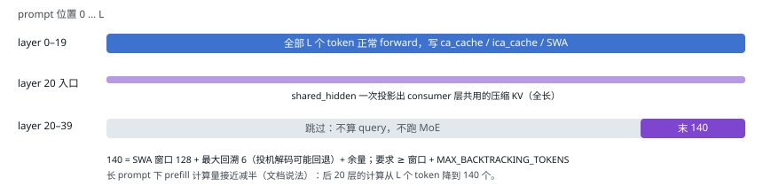

# 13 前缀缓存、YoCo 与有界重放

| 直觉 | vLLM 的做法 | DeepInfer 的做法 |
| --- | --- | --- |
| 多轮对话和 Agent 的输入大部分是上一轮重复的。如果之前算过的 KV 还在，就只需要 prefill 新增部分：prefill 成本可能降一个数量级。剩下的问题是：KV 能留多久、在哪、缺一部分怎么办。 | GPU 显存里的哈希块缓存，LRU 淘汰；外部存储需要接 KV connector（如 LMCache）。命中多少就复用多少。 | 块 KV 存外部 3FS（保留 3–7 天），引擎只接收「命中长度」；滑窗 KV 缺失时只重放最后 128 token。再加上 YoCo：后 20 层 prefill 只算末尾 140 个 token。 |

## 滑窗 KV 带来的新问题

分页的块 KV 很容易缓存：按块哈希、按块存取。但 V4.1 每层还有一份滑窗 KV，它是「最近 128 个位置」的状态，不按块对齐，没法和块 KV 一起分页共享。文档里的规则：块 KV 决定命中长度，滑窗 KV 只决定最后一块要不要重算。滑窗 KV 缺失时，只重放命中前缀的最后 128 个 token，把注意力窗口截在重放段内，得到一个近似的滑窗状态，成本是常数，和上下文长度无关。

## YoCo：后半个模型只看末尾

第一个 C1 层（layer 20）之前的层叫 prefill 侧，之后的叫 YoCo consumer（文档里叫 CED 架构的 decoder 层）。consumer 层的压缩 KV 全部来自 layer 20 入口的 hidden（第 12 节的跨层共享），它们自己只需要逐层算 SWA KV。开启截断后，consumer 层在 prefill 时**只对末尾 140 个 token 算 query**：

<small>为什么这样可行：decode 时 consumer 层的每个新 token 需要的是「layer 20 给出的全长压缩 KV」和「本层最近 128 个位置的 SWA KV」。前者已经一次算好；后者只需要末尾一段。中间那些位置在 consumer 层的输出，后面没有任何人会用到。开关：`DEEPINFER_YOCO_PREFILL_TRUNCATION_MODE=compact`、`DEEPINFER_YOCO_PREFILL_KEEP_TOKENS=140`（README 推荐值；代码默认 `off`）。代价是 consumer 层的 SWA KV 是近似重建的，所以截断模式下 `prompt_logprobs` 会被强制关闭。[`llm_engine.py:529`](https://github.com/deepseek-ai/DeepInfer/blob/9bd9cf243fc53ef9afbf8f04d391d989117d6ab9/deepinfer/engine/llm_engine.py#L529)</small>

`mask` 模式保留全部 query、只收窄 SWA 可见范围，计算量不变，用来验证和 `compact` 在数值上等价（`examples/yoco/`）。截断的元数据准备见 [`input_metadata/yoco.py:94`](https://github.com/deepseek-ai/DeepInfer/blob/9bd9cf243fc53ef9afbf8f04d391d989117d6ab9/deepinfer/model_executor/input_metadata/yoco.py#L94)。vLLM 里没有对应机制，因为这依赖 V4.1 的层间 KV 共享结构。

---

[← 上一篇](./12-attention-kv.md) · [交互版本节](https://middle-chunjie.github.io/deepinfer-visual-guide/interactive/#yoco) · [下一篇 →](./14-dspark.md)
