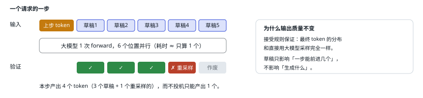
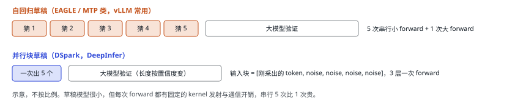
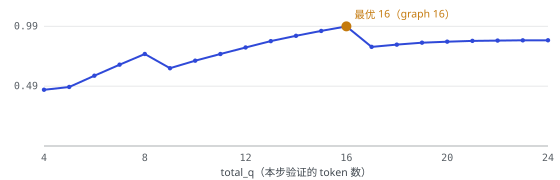
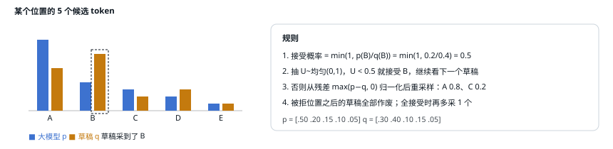

# 14 DSpark 投机解码

| 直觉 | vLLM 的做法 | DeepInfer 的做法 |
| --- | --- | --- |
| 第 05 节说过：decode 时 GPU 主要在搬权重，多算几个 token 几乎不加时间。那就先用一个便宜的小模型「猜」后面 5 个 token，再让大模型一步把它们全部检查一遍，猜对几个就一次前进几个。 | 支持 ngram、EAGLE/EAGLE3、MTP、草稿模型等；每步固定验证 `num_speculative_tokens` 个；EAGLE 类草稿逐个自回归生成。 | 3 层草稿模型一次 forward 并行出 5 个草稿，另带置信度头；调度器按置信度给每个请求分配不同的验证长度。 |

## 基本流程：猜 → 验 → 接受前缀

## 草稿怎么来：逐个猜 vs 一次猜 5 个

- 代码里叫 **DFlash**，配置字段叫 `dspark_*`。3 个草稿层，复用主模型的 embedding 和 lm_head，自带 128 专家 top-3 的小 MoE。[`dflash.py:82`](https://github.com/deepseek-ai/DeepInfer/blob/9bd9cf243fc53ef9afbf8f04d391d989117d6ab9/deepinfer/model_executor/models/mtp/dflash.py#L82)
- 输入特征来自主模型 layer 37/38/39 的 attention 输入（对 4 条残差流取均值），在主模型 forward 里顺手写进草稿层的 KV。
- 块长取 `DEEPINFER_USE_NEXTN_DECODE`（默认 5），与层数 3 无关；5 个位置的 hidden 一次得到，再逐位置采样（可选 Markov 头让前一个草稿影响后一个）。[`dflash.py:230`](https://github.com/deepseek-ai/DeepInfer/blob/9bd9cf243fc53ef9afbf8f04d391d989117d6ab9/deepinfer/model_executor/models/mtp/dflash.py#L230)
- 每个草稿还有一个**置信度头**：`sigmoid(w·[h ⊕ markov_emb] / T)`，预测它被接受的概率。

## 验证多少：按边际收益挑草稿

固定验证 5 个有浪费：有的请求在写代码，草稿基本都对；有的在写诗，第 2 个就错了，后面的验证算力白花。DSpark 的思路：草稿 j 被接受的前提是前面都被接受，所以位置接受率是置信度的累乘。调度器把所有请求所有位置的累乘值降序排，一个个加入验证集合，用实测的「graph 尺寸 → 耗时」曲线估算吞吐 = 期望接受数 ÷ 预计耗时，取最大值。[`mtp_varlen.hpp:150`](https://github.com/deepseek-ai/DeepInfer/blob/9bd9cf243fc53ef9afbf8f04d391d989117d6ab9/csrc/engine/mtp_varlen.hpp#L150)

[▶ 在交互版中换一组置信度试试](https://middle-chunjie.github.io/deepinfer-visual-guide/interactive/#spec)

下表是交互版的默认例子：4 个请求、每个 5 个草稿。格子里是累乘接受率（括号里是置信度头原始输出），✓ 表示被选中验证。按示意耗时曲线，最优是本步共验证 **16** 个 token（固定验证需要 24 个）。

| 请求 | 草稿 1 | 草稿 2 | 草稿 3 | 草稿 4 | 草稿 5 | 本步验证 |
| --- | --- | --- | --- | --- | --- | --- |
| 0 | **0.95（conf 0.95）** ✓ | **0.85（conf 0.90）** ✓ | **0.73（conf 0.85）** ✓ | **0.51（conf 0.70）** ✓ | 0.31（conf 0.60） | 5 个 token |
| 1 | **0.90（conf 0.90）** ✓ | **0.54（conf 0.60）** ✓ | 0.27（conf 0.50） | 0.11（conf 0.40） | 0.03（conf 0.30） | 3 个 token |
| 2 | **0.98（conf 0.98）** ✓ | **0.93（conf 0.95）** ✓ | **0.84（conf 0.90）** ✓ | **0.74（conf 0.88）** ✓ | **0.59（conf 0.80）** ✓ | 6 个 token |
| 3 | **0.70（conf 0.70）** ✓ | 0.35（conf 0.50） | 0.14（conf 0.40） | 0.04（conf 0.30） | 0.01（conf 0.20） | 2 个 token |

<small>每格上方是该位置的累乘接受率，下方小字是置信度头原始输出；蓝框 = 本步被选中验证。耗时曲线为示意：graph 尺寸按 `build_graph_batch_sizes(24, 8)` 分桶为 1/2/4/8/16/24，耗时 = 6 + 0.4×graph + 1（sampler）。吞吐曲线在同一个桶内阶梯上升，跨桶时下跌（多付了一整档 padding）。真实实现里选总数用 N−2 步的接受率、分配到请求用 N−1 步的，这里简化为同一组。</small>

官方文档给的生产数据：变长验证让每步平均验证长度从 5 降到 3.2–4.4，平均接受长度基本不变（3.29 → 3.20），在每卡约 60 并发时吞吐提升约 5%，并发越高收益越大（96 并发 +11%）。这符合第 05 节的直觉：并发越高，GPU 越接近算力瓶颈，「多验证几个几乎免费」就越不成立，省下的验证算力越值钱。

## 接受判定：拒绝采样

<small>这就是标准的投机采样拒绝规则（vLLM 的 RejectionSampler 用的也是它）。DeepInfer 的 kernel 实现：`U < exp(min(0, log p − log q))`，残差里给 q 乘了一个 `e−5e−5` 防止残差全为 0。[`cuda/fused_sample.py:391`](https://github.com/deepseek-ai/DeepInfer/blob/9bd9cf243fc53ef9afbf8f04d391d989117d6ab9/deepinfer/model_executor/layers/tilelang_ops/cuda/fused_sample.py#L391)</small>

> [!NOTE]
> <strong>置信度只决定「验证几个」，不参与「接不接受」。</strong>它即使估错了也只影响性能，不影响正确性。

---

[← 上一篇](./13-prefix-yoco.md) · [交互版本节](https://middle-chunjie.github.io/deepinfer-visual-guide/interactive/#spec) · [下一篇 →](./15-sampling.md)
