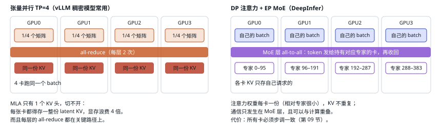
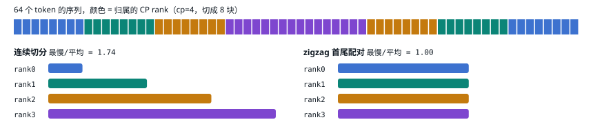

# 16 并行：DP / EP / CP / EPLB

| 直觉 | vLLM 的做法 | DeepInfer 的做法 |
| --- | --- | --- |
| 一张卡装不下、也跑不快整个模型。拆分方式决定了每张卡要读多少权重、存多少 KV、每层要通信几次。目标是第 05 节的杠杆 ④：每卡读的权重尽量少，同时通信尽量少。 | 稠密模型默认 TP（单机内把每个矩阵切开）；MoE 可开 DP 注意力 + EP，all-to-all 后端可选 DeepEP 等，EPLB 可选。 | 不用 TP：注意力纯 DP，MoE 纯 EP；decode 用 64–128 卡的宽 EP；长 prompt 用 zigzag CP；EPLB 复制热点专家。 |

## 先看懂：并行方式和通信方式

「并行」就是把模型或数据拆给多张卡一起做。一旦拆开，卡之间就要交换数据，这就是**通信**。不同的拆法对应不同的通信方式，通信的次数和数据量决定了这种拆法划不划算。先认识最常见的几种通信，后面读到这些名字就不会卡住：

<small>每行是一张卡（G0–G3），方块是它手里的数据，颜色区分数据来源。all-to-all 里方块的颜色表示「要发给谁」：通信之后，每张卡手里只剩下发给它自己的那几份。</small>

每种并行用哪种通信，对照下表：

| 并行方式 | 切的是什么 | 每卡持有 | 主要通信 | 频率 | DeepInfer |
| --- | --- | --- | --- | --- | --- |
| DP 数据并行 | 请求分开，模型整份复制 | 每卡一份完整模型（对注意力而言） | 推理时几乎不需要；DeepInfer 每步一次 all-reduce 做 prefill / decode 投票 | 低 | 注意力用 DP |
| TP 张量并行 | 每个矩阵切开 | 每个矩阵的 1/N | all-reduce，每层 2 次 | 高，且在关键路径上 | 不用 |
| PP 流水线并行 | 按层切成几段 | 连续的若干层 | send/recv，传段与段之间的激活 | 每段边界一次 | 本导读没有在 DeepInfer 里发现 PP 的用法 |
| EP 专家并行 | MoE 的专家分到不同卡 | 一部分专家 | all-to-all，每个 MoE 层 2 次（dispatch + combine） | 高，但可与计算重叠 | MoE 层用，decode 64–128 卡 |
| CP 上下文并行 | 一条长序列的 token 切成几段 | 序列的一段 | all-gather K/V | 每层注意力一次 | 长 prompt 的 prefill 用 |

> [!NOTE]
> **为什么 all-to-all 最贵：**all-reduce 和 all-gather 里每张卡传的数据大小相同，有成熟的环形、树形算法；all-to-all 里每张卡要和其他所有卡通信，64 卡就是 63 个对象，每份数据小而数量多。再加上各专家收到的 token 数不均匀，最慢的那张卡决定整步耗时。所以 EP 需要高速互联（NVLink 域内）、全组步调一致（第 09 节）和负载均衡（本节末尾的 EPLB）。这是通用的通信原理，不是 DeepInfer 源码里的结论。

数据具体走哪条线、用哪个库：

| 链路 / 库 | 是什么 | 说明 |
| --- | --- | --- |
| NVLink | 同一节点或超节点内的 GPU 之间 | 最快，EP 的 all-to-all 希望留在这个范围内 |
| PCIe | GPU 与 CPU、主板之间 | 较慢 |
| InfiniBand / RoCE | 跨节点的网络 | 比 NVLink 慢，跨节点通信要尽量少 |
| 共享内存 / ZMQ | 同一台机器上的 CPU 进程之间 | 用于 driver 向 follower 广播方法名等控制消息 |
| NCCL / HCCL | NVIDIA / 昇腾的多卡集合通信库 | all-reduce、all-gather 等都由它实现 |
| DeepEP | 专为 MoE 的 dispatch / combine 优化的通信库 | EP 的 all-to-all 常用它 |

## TP 和 DP+EP 的区别

<small>DP 注意力 + EP MoE 是 DeepSeek-V3 推理系统公开的方案，SGLang、vLLM 也都支持。DeepInfer 里注意力的线性层全是 `ReplicatedLinear`，没有 TP 代码路径；部署文档明确写「TP 和 CP 暂未在生产使用」。</small>

## 为什么 decode 要用 64 卡以上的宽 EP

<small>这就是文档说的「Wide-EP 显著减少 MoE 部分每步的显存流量」。代价是 all-to-all 的跨卡范围变大，所以要求 64–128 卡都在一个 NVLink 超节点（scale-up 域）内，并用 Mega MoE 把通信和计算融合。</small>

## CP：首尾配对的 zigzag 切分

超长 prompt 的 prefill 一张卡算太慢，就把一条序列切到多张卡上。因果注意力里越靠后的 token 要看的历史越长，计算量越大。如果连续切成 cp 段，最后一段最累。DeepInfer 把序列切成 `2·cp` 块，rank r 拿第 r 块和第 2cp−1−r 块，前后搭配后每个 rank 的计算量几乎相等。[`prepare_cp_mirror.py:126`](https://github.com/deepseek-ai/DeepInfer/blob/9bd9cf243fc53ef9afbf8f04d391d989117d6ab9/deepinfer/model_executor/layers/tilelang_ops/prepare_cp_mirror.py#L126)

[▶ 在交互版中切换 cp=2/4/8](https://middle-chunjie.github.io/deepinfer-visual-guide/interactive/#par)

| cp | 连续切分 最慢/平均 | zigzag 最慢/平均 |
| --- | --- | --- |
| 2 | 1.49 | 1.00 |
| 4 | 1.74 | 1.00 |
| 8 | 1.86 | 1.00 |

<small>条形长度 = 该 rank 承担的因果注意力 query×key 对数（相对值）。CP 只在 prefill 生效；attention 里 K/V 先 all-gather 再按反向索引还原顺序写入，所以每个 CP rank 存的是整条序列的 KV，切的是计算和激活，不是 KV 容量（从 `attn.py:828–855` 的写入路径推断）。</small>

## EPLB：热点专家复制

直觉：路由是模型自己学的，总有些专家特别热门。EP 下持有热门专家的卡每步收到的 token 最多，全组都要等它。解决办法是给热门专家多放几份副本，分摊到不同卡上。

1. MoE dispatch 时顺带统计每个专家收到的 token 数，存进环形窗口。[`eplb/__init__.py:113`](https://github.com/deepseek-ai/DeepInfer/blob/9bd9cf243fc53ef9afbf8f04d391d989117d6ab9/deepinfer/model_executor/eplb/__init__.py#L113)
2. 每隔 `DEEPINFER_EXPERT_REARRANGEMENT_STEP_INTERVAL` 步（引擎默认 0 = 关；示例脚本设 30），EP 组 all-reduce 窗口计数。
3. 策略：贪心把最热的逻辑专家复制到冗余槽位，再把物理槽位分到各卡，最小化窗口内各步的峰值负载。[`policy.py:73`](https://github.com/deepseek-ai/DeepInfer/blob/9bd9cf243fc53ef9afbf8f04d391d989117d6ab9/deepinfer/model_executor/eplb/policy.py#L73)
4. 单机经 IPC / symm_mem 搬权重，跨机走批量 P2P；gate 通过 `logical_to_physical_map` 路由到新位置。

vLLM 的 EPLB 机制相同（`--enable-eplb`，窗口 1000 步、每 3000 步重排、冗余专家默认 0）。DeepInfer 文档给出的生产参数：prefill 每卡 4 个冗余、100 步窗口、1000 步重排；decode 每卡 1 个冗余、1000 步窗口、10000 步重排，实测最慢 rank / 平均 ≈ 1.05–1.09。

> [!WARNING]
> <strong>默认值的坑：</strong>冗余专家数 `DEEPINFER_OVERRIDE_NUM_EXTRA_EXPERTS` 在引擎里默认是 0（只向上取整到能被 ep_size 整除），README 说的 32 是 `examples/_config.py` 设置的。自己写调用代码时要手动设。

---

[← 上一篇](./15-sampling.md) · [交互版本节](https://middle-chunjie.github.io/deepinfer-visual-guide/interactive/#par) · [下一篇 →](./17-kernels.md)
